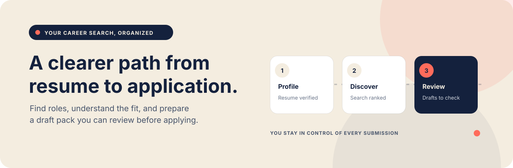

<p align="center">
  
</p>

<p align="center">
  <a href="https://github.com/joshuaadmissions-web/neural-ant/actions/workflows/ci.yml"></a>
  
  
</p>

<p align="center">
  <strong>A private workspace for a more focused job search.</strong><br>
  Upload your resume, find relevant roles, see why they match, and prepare drafts you can review before applying.
</p>

<p align="center">
  <a href="#quick-start"><b>Quick start</b></a>
  &nbsp; · &nbsp;
  <a href="#how-it-works"><b>How it works</b></a>
  &nbsp; · &nbsp;
  <a href="docs/deployment.md"><b>Deployment</b></a>
  &nbsp; · &nbsp;
  <a href="docs/ai-job-search-workflow-parity.md"><b>Workflow notes</b></a>
</p>

> Neural Ant prepares and tracks your application materials. You review the job, complete the employer's form, and submit it yourself.

## How it works

The Chat page combines the reference workflow—`/setup → /scrape → /rank → /apply`—in one action. Upload a PDF or DOCX resume, verify the extracted profile, then choose **Find & prepare jobs**.

| Step | What Neural Ant does |
|---|---|
| **Set up** | Extracts supported profile and application-history details from your resume for you to verify. |
| **Find** | Searches configured public job boards and a live remote tech-job index. |
| **Rank** | Scores role fit and keeps eligibility, language, location, work mode, contract type, and sponsorship evidence visible. |
| **Prepare** | Creates reviewable, job-specific resume and cover-letter drafts for up to five top-fit remote roles whose postings explicitly mention sponsorship. |
| **You apply** | You review the listing and drafts, then complete and submit the employer application yourself. |

Slash commands remain available for individual steps: `/setup`, `/scrape`, `/rank`, `/apply`, `/interview`, and `/outcome`. `/help` shows the command list. These commands open Neural Ant's feature screens; the command box is not a general-purpose chatbot.

## What you can do

- **Search public sources:** Greenhouse, Lever, Ashby, SmartRecruiters, Adzuna, and USAJOBS adapters, plus a live Freehire tech-job index search. Add board identifiers or API query sources yourself; this is not an all-platform aggregator.
- **Understand each match:** ranking uses technical skills (30%), experience (25%), work-style fit (15%), and career alignment (30%), with separate eligibility, language, and location gates. Scores are ranking aids, not ATS scores or hiring predictions.
- **Keep sponsorship evidence specific:** role language and historical employer filings are displayed separately. A past H-1B/LCA filing does not promise sponsorship for a particular opening. C2C is tracked as an employment type; it does not establish visa sponsorship.
- **Review before using AI drafting:** local drafts reorder existing resume content. An external AI provider is optional and requires an explicit opt-in; Neural Ant applies best-effort redaction before sending selected resume, profile, and job details. Review every generated document for accuracy.
- **Track the search:** shortlist roles, record stages and outcomes, save interview prep and follow-up drafts, and exclude completed or duplicate roles from future one-click preparation.
- **Use your own files and accounts:** optional MCP tools can search saved listings without exposing resume text or contact details. Email-status review works from messages you choose to paste; Notion export is a one-way CSV.

## Quick start

Requirements: macOS, Python 3.10 or newer, Node.js 20 or newer, and npm. Docker is not required for local use.

```bash
git clone https://github.com/joshuaadmissions-web/neural-ant.git
cd neural-ant
bash run-local.sh
```

On the first run, the script installs dependencies, builds the interface, and creates a local SQLite database. Open [http://127.0.0.1:8080](http://127.0.0.1:8080), upload your resume in **My profile**, confirm the extracted details, then configure employer boards under **Agent search**. Stop the app from Terminal with **Ctrl+C**.

Local mode stores the database and resume under `data/` and listens on your Mac only. It runs while the Mac and terminal process are active. Do not expose the local server to a network.

## Privacy and boundaries

- Neural Ant is designed for a single user. Local mode opens without a sign-in screen and binds to `127.0.0.1`; production mode uses password protection.
- Resume files are stored outside Git, in the local `data/` directory or an optional private volume / Google Cloud Storage bucket. Keep resumes, exports, credentials, and `.env` files out of this public repository.
- Freehire receives the role query and search filters, not your resume or work-authorization details.
- External AI processing happens only after you opt in. Redaction is best-effort and may miss unusual formats.
- Neural Ant does not scrape or reverse-engineer LinkedIn, fill employer forms, answer attestations, send recruiter messages, or submit applications.
- Verify job details, compensation, work authorization, and sponsorship with the employer. Historical filing data is context, not a role-specific commitment.

## Preview and deployment

[`site/`](site/) contains a static product preview; it does not connect to the app, search jobs, or collect resumes. See [deployment and local setup](docs/deployment.md) for local configuration, the static preview, and a full private Cloud Run deployment with persistent storage.

## Developer workflow

```bash
npm run build
python -m pip install -r requirements.txt
uvicorn api.main:app --env-file .env.local --reload --host 127.0.0.1 --port 8080
```

The API docs are available at `/api/docs` outside production mode. Frontend assets are built from `src/` into `dist/`.

## Documentation

| Guide | What's inside |
|---|---|
| [Deployment and local setup](docs/deployment.md) | Local run, static preview hosting, and full private cloud deployment. |
| [Workflow parity](docs/ai-job-search-workflow-parity.md) | Command-by-command comparison with the [`ai-job-search`](https://github.com/ai-job-search-dev/ai-job-search) workflow and current gaps. |
| [Job-source API notes](docs/job-source-apis.md) | Supported adapters, data sources, and API limitations. |
| [Matching research](docs/matching-research.md) | Rationale behind the fit dimensions and ranking gates. |
| [Local MCP setup](docs/local-mcp.md) | Connect Codex or VS Code to the local, read-only job-search tools. |
| [Static preview](site/README.md) | What the public preview includes and how to host it. |
| [Strawberry companion pack](strawberry/README.md) | Optional private job-search research and reporting materials. |

---

<p align="center"><sub>Built for careful job searching: clear evidence, reviewable drafts, and you in control of every application.</sub></p>
